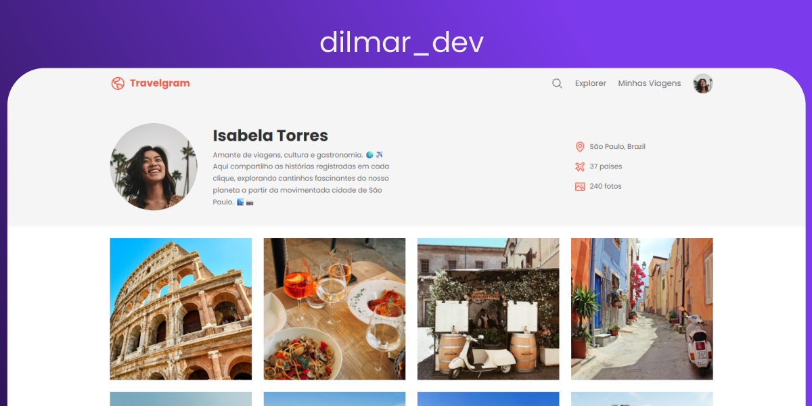

  

# 🌍 Travelgram

Travelgram é uma página de perfil de viagens desenvolvida para praticar a construção de interfaces web modernas e responsivas.

 ✨ Preview

A interface contém:

- 👤 Perfil do viajante
- 📍 Localização
- ✈️ Quantidade de países visitados
- 📸 Quantidade de fotografias
- 🖼️ Galeria de imagens
- 🔎 Barra de pesquisa
- 🧭 Navegação entre páginas
- 📱 Layout preparado para diferentes tamanhos de ecrã

## 🛠️ Tecnologias utilizadas

- HTML5
- CSS3
- Flexbox
- CSS Grid
- Design responsivo

 📚 Objetivo

Este projeto foi desenvolvido como parte dos meus estudos de desenvolvimento web, com foco em:

- Estruturação semântica com HTML
- Criação de layouts com CSS
- Utilização de Flexbox e Grid
- Organização de componentes visuais
- Responsividade
- Reprodução de interfaces a partir de referências visuais

 🎨 Interface

O projeto possui uma interface inspirada em plataformas de viagens, com foco em uma apresentação visual limpa e organizada.

 Perfil

O cabeçalho apresenta:

- Foto de perfil
- Nome
- Descrição
- Localização
- Número de países visitados
- Número de fotografias

Galeria

A seção principal apresenta uma coleção de fotografias organizadas em uma grade, criando uma experiência semelhante a um perfil de uma plataforma de viagens.

